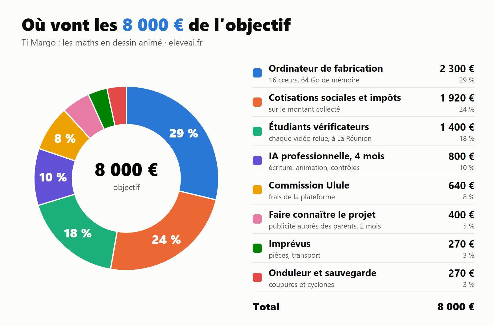

# Page Ulule — EleveAI × Ti Margo

> Texte prêt à coller, champ par champ, dans le formulaire Ulule.
> Mode : **collecte avec contreparties** · durée : **35 jours** · lancement conseillé : **début décembre**.
> Les passages entre [crochets] sont à compléter ou à vérifier avant la mise en ligne.

---

## 1. Titre du projet (≤ 50 caractères)

**Ti Margo : les maths en dessin animé**

Autres titres possibles :
- Apprendre les maths en dessin animé
- Les maths, enfin un dessin animé qu'on adore

## 2. Sous-titre / phrase d'accroche (≤ 135 caractères)

**Votre enfant regarde déjà des dessins animés. Aidez-nous à finir ceux qui lui apprennent les maths, de la grande section à la terminale.**

## 3. Catégorie et tags

- Catégorie : **Éducation** (secondaire : Film et vidéo)
- Tags : mathématiques, dessin animé, école, éducation, enfants, parents, primaire, collège

## 4. Objectif

**8 000 €** : l'ordinateur de fabrication et la vérification des vidéos (puis paliers à 12 000 €, 18 000 € et 31 000 €, voir plus bas)

---

## 5. Description du projet (le grand texte de la page)

### Votre enfant adore les dessins animés. Et si c'était comme ça qu'il apprenait les maths ?

Je m'appelle **Frédéric**, je suis professeur de mathématiques et statisticien de formation. Depuis plus d'un an, je crée pour mes propres élèves des **vidéos de maths** : des courtes en **dessin animé**, avec **Ti Margo**, et des plus longues pour bien comprendre.

Mes élèves les regardent **de leur plein gré**. Ils y passent du temps, ils rient, ils me posent des questions en classe sur ce qu'ils ont vu. Et ils progressent.

Aujourd'hui, j'ai besoin de vous pour **finir ce que j'ai commencé** et le mettre entre les mains de tous les enfants.

### Le constat : tout le monde décroche, et ça commence très tôt

Tous les parents le savent : **en 4e, beaucoup d'enfants décrochent en maths.** Mais le décrochage ne commence pas en 4e. Il commence bien avant, dans les bases : compter, comprendre les nombres, les fractions, les décimaux. Une base fragile en CE2 devient un mur en 4e.

Et la France va mal en maths : avec **PISA 2022**, nos élèves ont obtenu **le plus mauvais score jamais mesuré pour la France** en mathématiques.

Il ne faut pas *plus de la même chose*. Il faut **une autre façon d'apprendre**.

### Notre réponse : apprendre les maths comme on regarde un dessin animé

Sur **eleveai.fr**, chaque notion du programme est découpée en petites étapes (des « micro-notions »). Pour chacune :

- 🎬 **un dessin animé court avec Ti Margo** : une surprise, un jeu, une question qui donne envie de savoir ;
- 📺 **une vidéo plus longue** pour vraiment comprendre, pas à pas ;
- 🎯 **le Coach**, qui fait travailler l'enfant à son niveau, de facile à difficile, avec des **ceintures** comme au judo, de la blanche à la noire ;
- 🔊 **un coach qui se lit ET s'écoute**, pour les enfants qui ont du mal à lire ;
- 👨‍👩‍👧 **un suivi par enfant** : vous voyez ce qu'il a compris, notion par notion.

### La différence : ici, c'est un dessin animé qui explique

Sur la plupart des plateformes de soutien scolaire, les vidéos montrent **un adulte qui explique** face caméra ou devant un tableau. C'est sérieux, mais c'est souvent là que l'enfant décroche.

Chez nous, c'est **Ti Margo**, un personnage de **dessin animé**, qui lui fait découvrir les maths : il se trompe, il s'étonne, il pose des défis. L'enfant ne se dit pas « je fais des maths », il se dit « je regarde Ti Margo ».

C'est le langage que les enfants préfèrent, **de la grande section à la terminale**. Et mes élèves de 4e les regardent aussi avec plaisir.

### Ce qui existe aujourd'hui… et ce qui manquait

J'ai regardé ce que les familles ont déjà à leur disposition :

- les **plateformes d'exercices** suivent les compétences de l'enfant, mais leurs vidéos montrent un adulte qui explique, quand il y en a ;
- les **sites de soutien scolaire** proposent des vidéos de cours, parfois illustrées, mais avec des chapitres entiers plutôt qu'un suivi pas à pas, et rarement dès la maternelle ;
- les **émissions éducatives** sont gratuites et de qualité, mais elles ne suivent pas les progrès de votre enfant.

**À ma connaissance, aucun site ne réunit les quatre :**

| | EleveAI |
|---|---|
| Un **suivi par enfant**, micro-compétence par micro-compétence | ✅ |
| Une **vidéo animée** pour comprendre chaque étape | ✅ |
| Un **court dessin animé** avec un personnage que les enfants adorent | ✅ |
| **De la grande section à la terminale**, au programme français | ✅ |

C'est exactement ce que je veux construire avec vous.

**On ne vend pas des fiches d'exercices.** Il y en a déjà partout. Ce qu'on vous propose, c'est **un suivi pour votre enfant** et **une autre façon de rencontrer les maths** : avec le sourire.

Et les maths ne restent pas dans le cahier : chaque vidéo les montre dans la vraie vie, en cuisine, en sport ou en musique, et à travers des **métiers** qui font rêver.

### Ce qui existe déjà

Ce projet n'est pas une promesse sur papier. Il tourne déjà :

- ✅ **près de 1 500 vidéos** déjà produites et en ligne sur le site ;
- ✅ un **Coach** qui couvre le programme du CP à la terminale ;
- ✅ **environ 500 visites par jour** sur eleveai.fr, sans aucune publicité ;
- ✅ des vidéos testées **chaque semaine avec de vrais élèves**, dans ma classe.

C'est un **projet indépendant, né en classe**. Je l'ai construit seul, le soir et le week-end, parce que je vois chaque jour ce que ça change pour mes élèves.

### Ce qu'il reste à faire

Pour couvrir **tout le programme de la grande section à la terminale**, puis tout le collège, il faut produire et **vérifier** des milliers de vidéos. Chacune est relue par un enseignant avant d'arriver devant un enfant. **La qualité passe avant tout**, puisque ces vidéos sont projetées en classe.

Aujourd'hui, je suis au maximum de ce qu'un professeur seul, avec un ordinateur portable, peut produire.

### À quoi servira votre argent

**Objectif : 8 000 €, fabriquer plus, sans rien lâcher sur la qualité**

Aujourd'hui, tout est fabriqué sur un ordinateur portable. Chaque dessin animé et chaque vidéo y est calculé image par image, et un portable ne peut pas en produire des milliers. Mais fabriquer vite ne suffit pas : **chaque vidéo doit être juste avant d'arriver devant un enfant**. C'est pour ça que la vérification a une vraie place dans le budget.

| Poste | Montant | Part |
|---|---|---|
| Ordinateur de fabrication (16 cœurs, 64 Go de mémoire) | 2 300 € | 29 % |
| Cotisations sociales et impôts sur la collecte | 1 920 € | 24 % |
| Étudiants vérificateurs à La Réunion (chaque vidéo relue avant d'arriver devant un enfant) | 1 400 € | 18 % |
| IA professionnelle, 4 mois (écriture, animation, contrôles) | 800 € | 10 % |
| Commission Ulule | 640 € | 8 % |
| Faire connaître le projet aux parents (2 mois) | 400 € | 5 % |
| Imprévus | 270 € | 3 % |
| Onduleur et sauvegarde (coupures, cyclones) | 270 € | 3 % |
| **Total** | **8 000 €** | **100 %** |

**Palier 2 : 12 000 €, toute la GS → terminale vérifiée**
Des étudiants vérificateurs, futurs professeurs, relisent les vidéos qui restent, jusqu'à la terminale. Je garde la validation finale. Pour eux, c'est un vrai job et une vraie expérience d'enseignement.

**Palier 3 : 18 000 €, un an d'IA et de visibilité**
Le reste de l'année d'IA, l'hébergement du site, et de quoi faire connaître le projet à plus de familles.

**Palier 4 : 31 000 €, les pays francophones**
Le coach est construit sur une **matrice des programmes par pays**. Ce palier adapte les vidéos et leur vérification aux programmes des autres pays francophones, pour que chaque enfant y retrouve exactement ce qu'il voit en classe.

> Chaque euro est expliqué. Le détail complet sera publié dans les actualités de la campagne.

### Essayez avant de donner

**Faites le test avec votre enfant, c'est gratuit** : **eleveai.fr/coach**, sans compte et sans abonnement. Choisissez sa classe et une notion, et regardez-le répondre, réussir, se tromper, recommencer. Regardez-le aussi devant un dessin animé Ti Margo.

Le test gratuit ne garde rien en mémoire. **Le suivi dans la durée**, compétence par compétence, c'est ce que l'abonnement apporte. S'il sourit devant des maths, vous saurez pourquoi ce projet mérite d'exister.

### Un cadeau pour vos petits-enfants

Grands-parents, parrains, marraines : **offrez l'abonnement**. Vous recevez un **code cadeau** et une **carte Ti Margo à imprimer**, à glisser sous le sapin. L'enfant l'active quand il veut.

### Pourquoi vous ?

Parce qu'avec **10 €**, vous ne faites pas un don dans le vide : vous **participez à une nouvelle façon d'apprendre les maths**, et votre enfant en profite le premier.

---

## 6. Contreparties

> Prix de l'abonnement famille : 4,95 €/mois. Les mois offerts démarrent à l'ouverture de l'offre famille.

**5 € · Merci !**
Votre nom sur le **mur des soutiens** d'eleveai.fr + un fond d'écran Ti Margo.

**10 € · Le petit soutien** ⭐ *(la contrepartie phare)*
**2 mois d'abonnement famille** + le **petit film de remerciement de Ti Margo**, réservé aux contributeurs + tout ce qui précède.

**25 € · La ceinture jaune**
**6 mois d'abonnement famille** + tout ce qui précède.

**50 € · La ceinture verte**
**1 an d'abonnement famille** + un **diplôme Ti Margo** à imprimer au nom de l'enfant + tout ce qui précède.

**100 € · La ceinture noire**
**1 an pour 2 enfants** + **vous choisissez la passion ou le métier** mis en scène dans un futur dessin animé (football, danse, cuisine, pompier…) + tout ce qui précède.

**🎁 Les versions « à offrir »**
Toutes les contreparties de 10 € à 100 € existent en version cadeau : même abonnement, mais vous recevez un **code cadeau** et une **carte Ti Margo à imprimer** au prénom de l'enfant, pour Noël ou un anniversaire.

**60 € · Pour mes petits-enfants**
**3 codes cadeaux de 4 mois** à répartir entre vos petits-enfants + 3 cartes Ti Margo à imprimer.

**300 € · Pour les classes** *(enseignants, écoles, associations)*
**Licence classe pendant 1 an** (suivi de toute la classe) + **une visio en classe** avec moi + le nom de l'école sur le mur des soutiens.

**1 000 € · Partenaire** *(entreprises, mairies, comités d'entreprise)*
Votre logo sur la page des partenaires + **10 licences familles d'un an** à offrir (salariés, familles en difficulté…).

---

## 7. Script de la vidéo de présentation (1 min 45)

> **Les règles du CEO pour cette vidéo**
> - **Les 5 premières secondes décident de tout** : on ouvre sur Ti Margo, pas sur un visage ni sur un logo.
> - **Sous-titres incrustés** : sur Facebook et Instagram, 8 vidéos sur 10 sont regardées sans le son.
> - **On montre, on ne promet pas** : un vrai short, le vrai coach, le vrai suivi parent.
> - **Une seule demande à la fin** : « Faites le test, puis soutenez-nous. »
> - **⚠️ Élèves filmés** : jamais de visage sans autorisation écrite des parents et de l'établissement. Filmer de dos, les mains sur la tablette, ou le tableau projeté.

**[0:00, dessin animé, plein écran]**
Ti Margo se gratte la tête devant 3/4 et 2/3 : « Lequel est le plus grand ? … Attends, j'ai une idée ! » *(il découpe deux pizzas)*
→ 6 secondes extraites d'un vrai short : l'enfant comprend *avant* qu'on lui explique.

**[0:08, la classe, filmée de dos]**
Le short projeté au tableau, des mains qui se lèvent, des rires.
Voix de Frédéric : « Ça, c'est ma classe. Et ce dessin animé, c'est moi qui l'ai fait. »

**[0:15, Frédéric face caméra, dans sa classe]**
« Je suis Frédéric, professeur de maths à La Réunion. Tous les parents connaissent ce moment : en 4e, beaucoup d'enfants décrochent. Mais ça ne commence pas en 4e. Ça commence dans les bases, dès la maternelle. »

**[0:28, Frédéric]**
« Alors au lieu d'un adulte qui explique au tableau, j'ai fait parler un personnage de dessin animé : Ti Margo. Les enfants l'adorent, de la grande section à la terminale, et même mes 4e. »

**[0:38, écran du site, en accéléré]**
1. Un short Ti Margo (5 s).
2. La vidéo pour comprendre, pas à pas (5 s).
3. Le coach : une question, une bonne réponse, la ceinture qui change de couleur (5 s).
4. **La vue parent** : les micro-compétences de l'enfant, vertes, orange, grises (5 s).
Voix : « Un dessin animé pour avoir envie. Une vidéo pour comprendre. Un coach pour s'entraîner. Et vous, vous voyez ce que votre enfant maîtrise, compétence par compétence. »

**[1:00, Frédéric]**
« J'ai cherché un site qui fasse tout ça. Ça n'existait pas. Alors je l'ai construit. Près de 1 500 vidéos existent déjà, et 500 personnes visitent le site chaque jour, sans aucune publicité. »

**[1:12, Frédéric]**
« Mais pour finir tout le programme et vérifier chaque vidéo, je ne peux plus avancer seul. »

**[1:20, Frédéric, plus proche]**
« Faites le test : c'est gratuit, ça prend dix minutes, sur eleveai.fr. Regardez votre enfant devant Ti Margo. Et si vous le voyez sourire devant des maths, aidez-nous à finir. Dès 10 €, il a deux mois d'abonnement. Et vous pouvez aussi l'offrir à vos petits-enfants. »

**[1:35, dessin animé]**
Ti Margo, face caméra : « Alors… on le finit ensemble ? »

**[1:40, carton final, 5 s]**
*Ti Margo : les maths en dessin animé*
*Faites le test gratuit → eleveai.fr · Soutenez-nous → [lien Ulule]*

---

## 8. FAQ

**Pour quel âge ?**
La campagne finance les vidéos de la **grande section à la terminale**, chacune vérifiée avant sa mise en ligne.

**Je peux voir les vidéos avant de participer ?**
Oui : beaucoup sont déjà en accès libre sur eleveai.fr et sur la chaîne YouTube @eleveai974.

**Quand mon abonnement démarre-t-il ?**
À l'ouverture de l'offre famille, [fin décembre / date exacte], ou dès la fin de la campagne si elle est déjà ouverte. Vous recevrez un code par courriel.

**Je peux tester avant ?**
Oui, et c'est même conseillé : le test est gratuit sur **eleveai.fr/coach**, sans compte, sans abonnement et sans carte bancaire. Seul le suivi des progrès dans la durée demande un abonnement.

**Je veux offrir l'abonnement à mes petits-enfants, comment faire ?**
Choisissez une contrepartie « à offrir ». Vous recevez par courriel un code cadeau et une carte à imprimer. Les parents de l'enfant n'ont qu'à entrer le code sur eleveai.fr. Le code reste valable [12 mois].

**L'IA remplace-t-elle le professeur ?**
Non. L'IA aide à **fabriquer** les vidéos plus vite. Chaque script est écrit et validé par un enseignant, et chaque vidéo est relue avant d'arriver devant un enfant.

**Mon enfant passe déjà trop de temps sur les écrans…**
Justement : les dessins animés font quelques minutes et finissent par une question. C'est du temps d'écran qui fait réfléchir, pas qui fait défiler.

**Et si l'objectif n'est pas atteint ?**
Vous êtes remboursé intégralement, comme sur toute collecte Ulule « tout ou rien ».

**Je suis enseignant, je peux l'utiliser en classe ?**
Oui, c'est fait pour ça : les vidéos sont conçues pour être **projetées en classe**. La contrepartie à 300 € comprend une licence classe.

---

## 9. Messages pour les réseaux (lancement)

**Facebook / Instagram (parents)**
> Votre enfant adore les dessins animés ? 🎬 Ici, pas d'adulte qui explique au tableau : c'est Ti Margo, un personnage de dessin animé. Moi, prof de maths, j'ai créé ces dessins animés qui apprennent les maths, de la GS à la terminale. Mes élèves les regardent tous les jours. Pour finir tout le programme, j'ai besoin de vous : dès 10 €, votre enfant reçoit 2 mois d'abonnement. 👉 [lien Ulule]

**Version courte (story, WhatsApp)**
> 🎬 Ti Margo : les maths en dessin animé. Aidez-nous à les finir ! Dès 10 €, 2 mois offerts. 👉 [lien]

**Pour les grands-parents** (Facebook, à partager par les parents)
> Cette année, sous le sapin : un abonnement de maths en dessin animé 🎄 Ti Margo fait aimer les maths aux enfants, de la grande section à la terminale. Offrez-le à vos petits-enfants, avec une carte Ti Margo à imprimer. Et testez d'abord, c'est gratuit : eleveai.fr 👉 [lien Ulule]

**Pour les collègues enseignants**
> Je lance une collecte pour finir mes vidéos de maths en dessin animé (GS → terminale), pensées pour être projetées en classe. Une licence classe est proposée en contrepartie. Si ça peut servir à vos élèves, partagez ! 👉 [lien]

---

## 10. À régler AVANT la mise en ligne

- [ ] Statut et **SIRET** (Ulule et Stripe les demandent)
- [x] **Cumul d'activités** : accord du rectorat (confirmé le 07/11)
- [x] Test gratuit : marche sans compte ni abonnement, sans suivi (confirmé le 07/11) ; adresse **eleveai.fr/coach**
- [ ] Facultatif : une adresse `eleveai.fr/ulule` qui mène au coach avec `utm_source=ulule`, pour compter les visiteurs venus de la collecte (aujourd'hui, `/coach` les compte comme venant de YouTube)
- [ ] Codes cadeaux : à générer (une ligne par code dans Supabase) + carte Ti Margo à imprimer (PDF)
- [ ] Date d'ouverture de l'offre famille, pour la promesse des abonnements
- [ ] Vérifier la commission Ulule exacte et le taux URSSAF, puis ajuster le tableau du budget (détail : `budget.md`)
- [ ] Tourner la vidéo de présentation (script ci-dessus)
- [ ] Prévenir 30 à 50 proches pour qu'ils participent **dès le premier jour** : une campagne qui atteint 30 % le premier jour réussit presque toujours
- [ ] Contacter la presse locale (Clicanoo, Réunion la 1ère, Le Quotidien) avec le lien de prélancement
